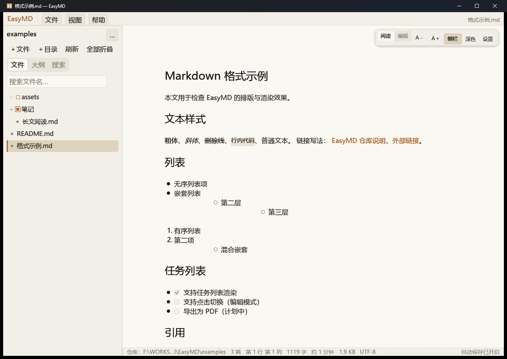
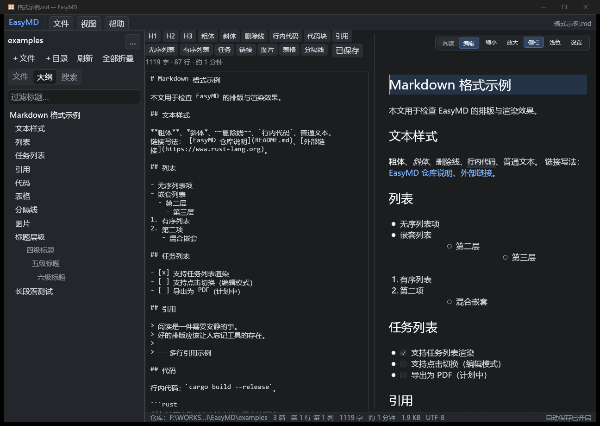
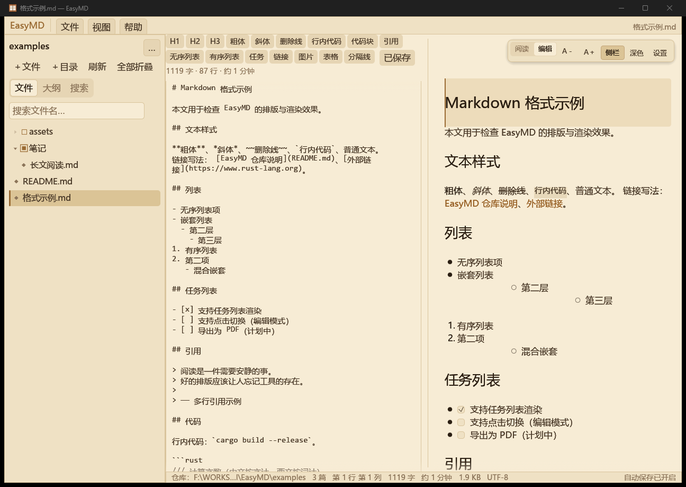

# EasyMD

**English** | [简体中文](README.md)

> A featherweight local Markdown reader & manager for knowledge bases, technical docs and long-form reading.
> Pure Rust, single-file executable, Windows / Linux — **no Electron, WebView2, Node or .NET required**



<table>
<tr>
<td width="50%"></td>
<td width="50%"></td>
</tr>
</table>

## Features

**Reading**
- Starts in reading mode: centered column, font size / line spacing / column width tuned for long-form reading and fully adjustable
- Headings, paragraphs, blockquotes (nested), ordered / unordered / task lists, tables, fenced code with syntax highlighting, images, rules
- **Wide tables and long code lines wrap automatically** — no horizontal scrolling
- Heading anchors: jump from the outline tab; relative links inside a document (`../`, `%20`, `#anchor`) open in-app
- **Per-document reading position** is remembered — switching away and back, or restarting, keeps your place
- 8 built-in themes (paper, pure white, sepia, eye-care green, graphite, midnight blue, warm night, polar), plus custom colors, background images and system fonts
- Zen mode (`F11`) hides every UI element except the text

**Editing**
- **Source on the left, live preview on the right**: draggable splitter, line-level sync — scrolling follows, the block under the cursor is highlighted precisely in the preview, and clicking the preview moves the editor caret to the matching line
- Toolbar inserts headings, bold, italic, strikethrough, inline code, code blocks, quotes, lists, links, images, tables, rules
- Auto-save; the status bar shows word / line count, reading time and file size

**Managing & searching**
- Lazy-loading tree with virtualized rendering — tens of thousands of entries stay smooth; create / rename / delete / drag-move (deletion is confirmed)
- Filename search, natural sort (`ch2` before `ch10`), sort by modified time, folders first
- Repository-wide full-text search on a background thread: filename + line number + matching context, click to jump
- External file changes reload automatically; conflicts with unsaved edits only warn, never interrupt

## Getting started

1. Download `easymd.exe` (Windows) or `easymd` (Linux) and run it — no installation needed.
2. On first launch click **Open repository** and pick your Markdown folder. After that EasyMD returns to the last repository and reading position.

You can also open a folder or file from the command line, or drag one onto the window:

```bash
easymd                    # reopen the last repository
easymd ~/notes            # open a specific repository
easymd ~/notes/readme.md  # open a file directly (its folder becomes the repository)
```

The bundled `examples/` folder is a small repository you can explore the features with.

## Keyboard shortcuts

| Shortcut | Action | | Shortcut | Action |
| --- | --- | --- | --- | --- |
| `Ctrl+O` | Open repository | | `Ctrl+B` | Toggle sidebar |
| `Ctrl+Shift+O` | Open a single file | | `Ctrl+E` | Edit mode (source + preview) |
| `Ctrl+S` | Save current document | | `Ctrl+R` | Reading mode |
| `Ctrl+N` | New file | | `Ctrl+D` | Toggle light / dark theme |
| `Ctrl+Shift+N` | New folder | | `Ctrl+=` / `Ctrl+-` | Font size up / down |
| `F2` | Rename selection | | `Ctrl+0` | Reset font size |
| `Delete` | Delete selection (confirmed) | | `Ctrl+W` | Close current document |
| `F5` | Refresh tree | | `Alt+←` / `Alt+→` | Back / forward |
| `Ctrl+F` | Search filenames | | `F11` | Zen mode |
| `Ctrl+Shift+F` | Full-text search | | `Ctrl+,` | Settings |
| `Ctrl+/` | Shortcut list | | `Ctrl+wheel` | Zoom font size |
| `↑` `↓` | Move in the tree | | `←` `→` | Collapse / expand folder |
| `Enter` | Open selected file | | `Space` | Collapse / expand folder |
| `Esc` | Close dialog / exit search / exit zen mode | | | |

## Markdown support

Rendering is built on [pulldown-cmark](https://github.com/pulldown-cmark/pulldown-cmark) (CommonMark) and [egui_commonmark](https://github.com/lampsitter/egui_commonmark), with GFM tables, task lists, strikethrough, footnotes, definition lists, heading attributes (`{#id}` anchors), nested blockquotes, relative-path images and in-repo document links enabled.

Not supported: inline HTML rendering (shown as plain text), automatic downloading of remote images (offline-first), LaTeX math rendering.

## Configuration & data

- **Windows**: `%APPDATA%\EasyMD\config.json`
- **Linux**: `$XDG_CONFIG_HOME/EasyMD/config.json` (default `~/.config/EasyMD/config.json`)
- **Portable mode**: put an `easymd.json` next to the executable and the config is written there instead — handy on a USB stick
- Log file: `easymd.log` in the same directory. Delete the config file to reset to defaults.

Stored settings include: last repository, recent repositories and files, view mode, theme and custom colors, font / size / line spacing / column width, sorting and display preferences, per-document reading positions, window size and position.

## Building from source

Rust 1.82 or newer is required (<https://rustup.rs>).

```bash
build.cmd                # Windows (CMD / PowerShell)
./build.sh               # Linux / macOS / Git Bash
cargo build --release    # manual build; output in target/release/easymd[.exe]
```

The scripts also work around a missing MinGW binutils `dlltool` on the Windows GNU toolchain by building a small shim in `tools/dlltool-shim`.

Linux dependencies (windowing / OpenGL / file dialogs — GTK3 backs the open dialogs):

```bash
sudo apt install build-essential pkg-config \
                 libxkbcommon-dev libgl1-mesa-dev libegl1-mesa-dev \
                 libwayland-dev libx11-dev libxcursor-dev libxi-dev libxrandr-dev \
                 libudev-dev libgtk-3-dev

# CJK and symbol fonts, otherwise Chinese text and icons render as boxes
sudo apt install fonts-noto-cjk fonts-noto-core fonts-symbola fonts-dejavu-core
```

To produce a Linux binary from Windows, WSL is the easiest route — the helper script copies the sources to the Linux side before compiling, avoiding the slow `/mnt` 9p round-trips:

```bash
# Run from Git Bash on Windows; substitute the path where your EasyMD checkout
# appears inside WSL (e.g. /mnt/c/... for C:\..., /mnt/f/... for F:\...)
MSYS_NO_PATHCONV=1 wsl -d Ubuntu-24.04 -- bash \
  /mnt/c/path/to/EasyMD/tools/wsl-build.sh --test
```

The equivalent container build:

```bash
docker run --rm -v "$PWD":/w -w /w rust:1-bookworm bash -c "
  apt-get update && apt-get install -y --no-install-recommends \
    libxkbcommon-dev libwayland-dev libx11-dev libxcursor-dev libxi-dev \
    libxrandr-dev libudev-dev libgtk-3-dev libgl1-mesa-dev pkg-config &&
  cargo build --release"
```

The Windows `easymd.exe` is a native binary (`x86_64-pc-windows-gnu`) and does not run on Linux in any useful way; rebuild on the target platform instead. Platform-specific code lives behind `cfg` branches (font fallback, external links, config directory, file manager).

## Tests

```bash
./build.sh test     # or: cargo test --release
```

Covering full-text search, the tree model (filtering, expansion, natural sort, counts), document parsing (anchor injection, link classification, line mapping), filename validation, relative-path and `%20` resolution, text statistics, block-range detection and two-pane coordinate mapping.

## Performance

Measured on Windows 11, release build, 1200×860 window, with a 1100-character Chinese document open:

| Metric | Value |
| --- | --- |
| Executable | **9.0 MB** (single file, no bundled runtime) |
| Launch to first frame | ~0.7 s |
| **Private working set** (Task Manager "Memory") | **~39 MB** (a blank egui window already uses 29 MB) |
| Idle CPU | 0% (nothing repaints while idle) |

For comparison, an Electron / WebView app with the same feature set typically needs 250–500 MB of RAM and an 80–150 MB installer.

## Design notes

- **egui (immediate-mode GUI) instead of a web stack**: no JS bridge or DOM, fast cold start, predictable memory, single-file distribution and true cross-platform behavior. The trade-off is less refined typesetting than a browser, so line spacing, column width and font size are adjusted explicitly.
- **Rendering reuses `egui_commonmark` + `pulldown-cmark`** rather than a hand-written parser — stability first on nested lists, tables and footnotes. The optional `syntect` highlighter is disabled in favor of the lighter one shipped with `egui_extras`, which also follows the active theme.
- **Heading anchors**: a GitHub-style anchor is added to headings in the text copy used for rendering only, so the source file and the editor content are untouched.
- **Relative-path images**: a dedicated `easymd://` resource protocol resolves "document directory + relative path" and keeps image caches isolated per document.
- **Fonts**: system font enumeration plus memory-mapped loading (no copies, negligible private memory); vertical metrics are unified across faces so CJK, proportional and monospace text share one baseline.
- **`vendor/egui_commonmark`**: a local copy with minimal patches (content-driven table column widths, render anchors, text-block click reporting). See its `PATCHES.md` for the patches and how to re-apply them when bumping upstream.

## Known limitations

- Math (`$...$`) renders as plain text; inline HTML is not parsed
- One document open at a time (switch via history and recent files)
- Deletion is permanent (with confirmation) — no recycle-bin integration
- No encoding-conversion UI: UTF-8 / UTF-8 BOM / UTF-16 / GBK are detected automatically and written back in the original encoding

## Project layout

```
src/
  main.rs        entry point, CLI arguments, window icon
  app.rs         application state, layout, shortcuts, actions
  explorer.rs    left panel (tree / outline / full-text search)
  reader.rs      reading pane (rendering, links, scroll memory, background)
  editor.rs      editing pane (format toolbar, tab indent, caret placement)
  settings.rs    settings panel
  dialogs.rs     dialogs (new, delete confirmation, messages, about, shortcuts)
  ui_ext.rs      shared widgets (toasts, segmented control, splitter, highlighted text)
  theme.rs       themes, colors, background-image painting
  fonts.rs       system font enumeration, loading, line-height adjustment
  loader.rs      custom easymd:// resource loader
  tree.rs        tree model (lazy loading, sorting, filtering, flattening)
  doc.rs         document model (outline, statistics, encoding, scroll position)
  fs_ops.rs      file operations (with validation) and encoding-aware I/O
  search.rs      full-text search (background thread)
  watch.rs       file-change watching (debounced)
  config.rs      config persistence
  util.rs        path / time / text helpers
examples/        sample document repository
vendor/          egui_commonmark local patched copy (see PATCHES.md)
tools/dlltool-shim/  dlltool shim for Windows GNU toolchains without MinGW
docs/screenshots/    UI screenshots
```

## License

MIT
