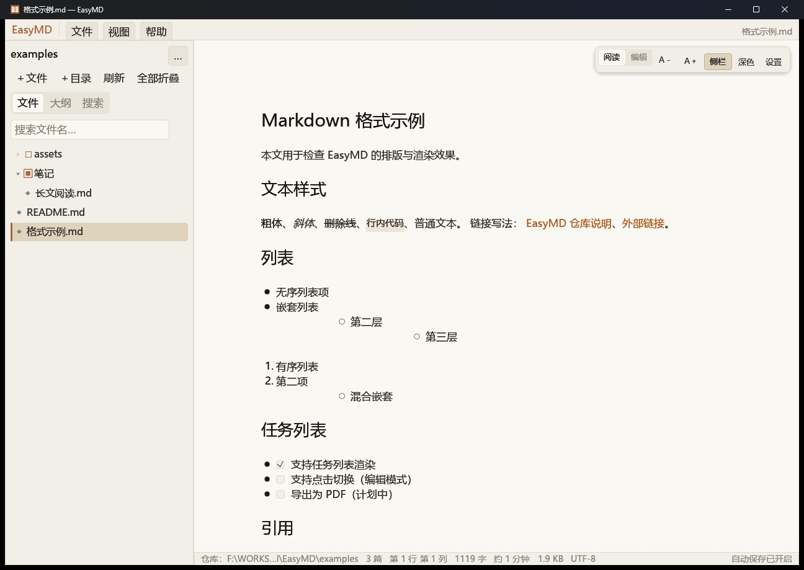
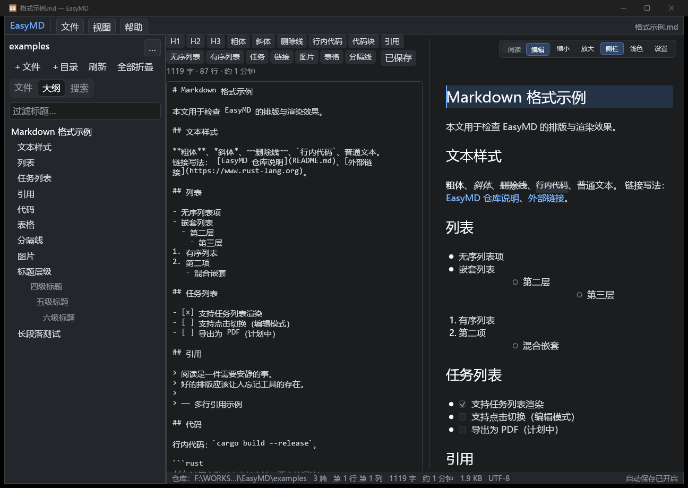
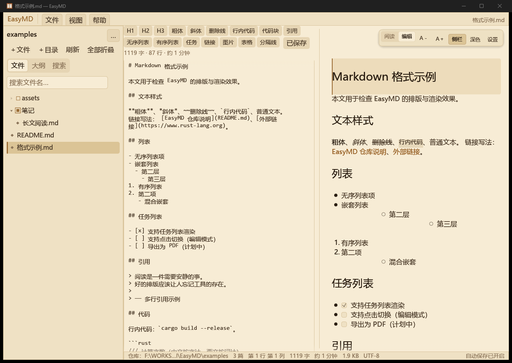

# EasyMD

> 超轻量化的本地 Markdown 知识库 · 技术文档 · 个人笔记阅读与管理器
> 纯 Rust 实现，单文件可执行，Windows / Linux 通用，**不依赖 Electron、WebView2、Node 或 .NET**



<table>
<tr>
<td width="50%"></td>
<td width="50%"></td>
</tr>
</table>

---

## 目录

- [特性一览](#特性一览)
- [快速开始](#快速开始)
- [界面说明](#界面说明)
- [快捷键](#快捷键)
- [Markdown 支持范围](#markdown-支持范围)
- [配置与数据](#配置与数据)
- [从源码构建](#从源码构建)
- [性能与资源占用](#性能与资源占用)
- [设计取舍](#设计取舍)
- [已知限制](#已知限制)

---

## 特性一览

**阅读**
- 默认进入阅读模式，正文栏宽居中、行距与字号按长文阅读调优
- 支持标题、段落、引用、列表、嵌套列表、表格、任务列表、链接、代码块、行内代码、图片、分隔线
- 代码块语法高亮（Rust / Python / JS / C / Shell / JSON / YAML 等常见语言）
- 标题锚点导航（大纲页签可直接跳转，也可右键「在编辑模式中定位」）
- 点击 Markdown 里的相对链接直接在应用内打开目标文档（支持 `../`、`%20`、`#锚点`）
- **超宽表格会在阅读栏宽内自动换行**（列宽按列数均分、单元格文字折行），
  不需要横向滚动也能看到完整内容；代码块长行同样自动折行
- 图片自动限制在阅读栏宽内，相对路径按文档所在目录解析
- **每篇文档独立记忆阅读位置**，切走再回来仍在原处；关闭后重启依然保留
- 右上角悬浮按钮切换 **阅读 / 编辑** 两种模式，设置全局生效并自动记忆
- **编辑模式 = 左侧源码 + 右侧实时预览**：中间分隔条可拖动，两栏**行级联动**
  （滚任一栏另一栏跟着走；光标所在块在预览里**精确高亮**——锚点取自实际绘制出的元素矩形；
  点预览可把编辑器光标定位到对应行）

**编辑**
- 等宽字体编辑区，支持自动换行、Tab 缩进、Ctrl+Z 撤销
- 一键插入 H1~H3、粗体、斜体、删除线、行内代码、代码块、引用、有序/无序/任务列表、链接、图片、表格、分隔线
- 左右分栏实时预览，中间分隔条可拖动
- 自动保存（切换文档、退出、停止输入 3 秒后各存一次），状态栏实时显示字数 / 行数 / 阅读时长 / 文件体积

**文档管理（左侧资源管理器）**
- 目录树按需加载，长目录使用虚拟列表渲染，几万条目也不卡
- 点击列表**空白处（或左上角仓库名）= 取消选中，操作目标回到仓库根目录**，
  因此展开任意层级后都能一键回到根目录新建文件；空白处右键还有「新建 / 展开折叠 / 刷新」菜单
- 新建文件 / 新建文件夹 / 重命名 / 删除 / 拖拽移动（含合法性校验，删除必须二次确认）
- 文件名快速搜索、按名称（自然排序，`第2章` 在 `第10章` 前）或修改时间排序、文件夹优先、倒序
- 隐藏文件与非 Markdown 文件可按设置显示
- 键盘导航（↑↓←→ / Enter / Space / F2 / Delete）与完整右键菜单
- 支持外部改动监听：其它程序修改文件时自动重新载入（本地有未保存内容时只提示、不打断；
  自己保存触发的写入事件通过「磁盘内容 vs 内存内容」比对识别并忽略，不会误报）

**查找**
- 侧栏「搜索」页签：整个仓库全文检索，后台线程扫描不卡界面，结果显示文件名 + 行号 + 命中上下文
- 点击结果直接跳到对应位置，长文定位一步到位

**外观**
- 8 套内置主题：纸白 / 纯白 / 羊皮纸 / 护眼绿 / 石墨 / 午夜蓝 / 暖夜 / 极地
- 自定义阅读区背景色、正文颜色、强调色
- 自定义背景图片（铺满 / 适应 / 平铺 / 原尺寸，可调不透明度与文字蒙版）
- 系统字体选择（自动标注含中文的字体）、字号、行距、阅读栏宽、界面紧凑度
- 禅模式（F11）隐藏全部界面元素，只留正文

---

## 快速开始

1. 下载 `easymd.exe`（Windows）或 `easymd`（Linux），**双击即可运行**，无需安装。
2. 首次启动点击「打开文档仓库」选择你的 Markdown 文件夹。
3. 之后每次启动都会自动回到上次的仓库，记忆上次打开的文档与阅读位置。

也可以用命令行打开指定目录或文件：

```bash
easymd                      # 打开上次的仓库
easymd D:\notes             # 指定仓库目录
easymd D:\notes\笔记\xxx.md # 直接打开某个文件（自动以所在目录为仓库）
```

把文件或文件夹**直接拖进窗口**也可以打开。

仓库里自带一份示例文档（`examples/`），可以先用它熟悉各项功能。

---

## 界面说明

```
┌────────────────────────────────────────────────────────────────────┐
│ EasyMD   文件  视图  帮助                    当前文件相对路径        │ 顶栏
├──────────────┬─────────────────────────────────────────────────────┤
│ 仓库名    …  │                ┌──────── 阅读 编辑 分栏 ────────┐    │
│ ＋文件 ＋目录 │                │  A-  A+  深色  侧栏  设置      │    │ 右上角悬浮按钮
│ 刷新 全部折叠 │                └────────────────────────────────┘    │
│ ┌ 文件 大纲 搜索 ┐            标题                                 │
│ │ 搜索文件名…    │                                                  │
│ ├────────────────┤            正文（栏宽居中，独立滚动）             │
│ │ ▢ 文件夹       │                                                  │
│ │  ◆ 文档.md     │                                                  │
│ └────────────────┘                                                  │
├──────────────┴─────────────────────────────────────────────────────┤
│ 仓库：…   12 篇   第 3 行 第 1 列   2,480 字   约 6 分钟   UTF-8     │ 状态栏
└────────────────────────────────────────────────────────────────────┘
```

- 侧栏三个页签：**文件**（目录树）、**大纲**（当前文档标题）、**搜索**（全文检索）
- 右上角悬浮按钮（紧凑尺寸）：阅读 / 编辑切换、字体缩放、深浅色、侧栏开关、设置
- 编辑模式 = 左侧源码 + 右侧实时预览，中间分隔条可拖动；两栏行级联动：
  滚任一栏另一栏跟随、光标所在块在预览中高亮、点预览可把编辑器定位到对应行

---

## 快捷键

| 快捷键 | 作用 | | 快捷键 | 作用 |
| --- | --- | --- | --- | --- |
| `Ctrl+O` | 打开文档仓库 | | `Ctrl+B` | 显示 / 隐藏侧栏 |
| `Ctrl+Shift+O` | 打开单个文件 | | `Ctrl+E` | 编辑模式（左源码 + 右预览） |
| `Ctrl+S` | 保存当前文档 | | `Ctrl+R` | 切换到阅读模式 |
| `Ctrl+N` | 新建文件 | |  |  |
| `Ctrl+Shift+N` | 新建文件夹 | | `Ctrl+D` | 深浅色主题切换 |
| `F2` | 重命名选中项 | | `Ctrl+=` / `Ctrl+-` | 放大 / 缩小字号 |
| `Delete` | 删除选中项（需确认） | | `Ctrl+0` | 重置字号 |
| `F5` | 刷新目录树 | | `Ctrl+W` | 关闭当前文档 |
| `Ctrl+F` | 搜索文件名 | | `Alt+←` / `Alt+→` | 后退 / 前进 |
| `Ctrl+Shift+F` | 仓库全文检索 | | `F11` | 禅模式 |
| `Ctrl+/` | 快捷键列表 | | `Ctrl+,` | 打开设置 |
| `↑` `↓` | 目录树上下移动 | | `←` `→` | 折叠 / 展开文件夹 |
| `Enter` | 打开选中文件 | | `Space` | 展开 / 折叠文件夹 |
| `Esc` | 关闭对话框 / 退出搜索 / 退出禅模式 | | `Ctrl+滚轮` | 缩放字号 |

---

## Markdown 支持范围

使用 [pulldown-cmark](https://github.com/pulldown-cmark/pulldown-cmark)（CommonMark 规范实现）+ [egui_commonmark](https://github.com/lampsitter/egui_commonmark) 渲染，已启用：

GFM 表格 · 任务列表 · 删除线 · 脚注 · 定义列表 · 标题属性（`{#id}` 锚点）· 数学公式占位 · 引用块（含嵌套）· 相对路径图片 · 本地文档互链

不支持：内联 HTML 渲染（原样显示为文本）、远程图片自动下载（离线优先，`http(s)` 图片会显示加载失败占位）、LaTeX 公式渲染（需自行接入数学渲染函数）。

---

## 配置与数据

配置文件位置：

- **Windows**：`%APPDATA%\EasyMD\config.json`
- **Linux**：`$XDG_CONFIG_HOME/EasyMD/config.json`（默认 `~/.config/EasyMD/config.json`）

**便携模式**：在可执行文件同级目录放一个 `easymd.json`，配置就写到那里（适合放 U 盘随身携带）。

配置里保存的内容包括：上次打开的仓库、最近打开的仓库与文件、视图模式、主题与自定义配色、字体与字号/行距/栏宽、排序与显示偏好、每篇文档的阅读位置、窗口尺寸与位置。

日志（排查问题用）：同目录下的 `easymd.log`。删除配置文件即可恢复默认状态。

---

## 从源码构建

需要 Rust 1.82 或更高版本（`rustup` 安装：<https://rustup.rs>）。

### 最简单的方式

```bash
# Windows（CMD / PowerShell）
build.cmd

# Linux / macOS / Git Bash
./build.sh
```

脚本会自动处理 Windows 上 GNU 工具链缺少 MinGW binutils 的情况（见下节），产物在 `target/release/easymd.exe`（Linux 为 `target/release/easymd`）。

### 手动构建

```bash
cargo build --release      # 需要本机已有可用的 C 链接器（MSVC 或 MinGW-w64）
```

**Linux 额外依赖**（窗口 / OpenGL / 文件对话框）：

```bash
# Debian / Ubuntu
sudo apt install build-essential pkg-config \
                 libxkbcommon-dev libgl1-mesa-dev libegl1-mesa-dev \
                 libwayland-dev libx11-dev libxcursor-dev libxi-dev libxrandr-dev \
                 libudev-dev libgtk-3-dev
```

`libgtk-3-dev` 是「打开文件夹 / 打开文件」对话框需要的：Linux 上 rfd 走 GTK3 后端
（XFCE 这类环境不保证在跑 `xdg-desktop-portal`，走 portal 时会点了没反应）。

**Linux 运行时还需要字体**，否则中文与图标会显示成方框：

```bash
sudo apt install fonts-noto-cjk fonts-noto-core fonts-symbola fonts-dejavu-core
```

### 跨平台说明

Windows 上构建出的 `easymd.exe` 是 **Windows 原生程序**（x86_64-pc-windows-gnu），
**不能直接在 Linux / macOS 上运行**——Wine 之类虽然能勉强跑，但字体、文件对话框、
图形栈都对不上，没有实际意义。EasyMD 是纯跨平台源码，在目标系统上重新编译即可
（`./build.sh` 或 `cargo build --release`）；平台相关代码都在 `cfg` 分支里
（字体回退、外部链接、配置目录、文件管理器），`cargo check --target x86_64-unknown-linux-gnu`
可以过。

只从 Windows 出发、想直接拿到一个 Linux 可执行文件，用 **WSL** 最省事：

```bash
# 在 Windows 的 Git Bash 里执行（注意 MSYS_NO_PATHCONV，否则 /mnt/... 会被改写）
MSYS_NO_PATHCONV=1 wsl -d Ubuntu-24.04 -- bash \
  /mnt/c/path/to/EasyMD/tools/wsl-build.sh --test
```

`tools/wsl-build.sh` 会把源码复制到 Linux 侧再编译（`/mnt` 走 9p，直接在那里编译会慢好几倍），
跑完把 ELF 拷到 `dist/easymd-linux-x86_64`，并列出运行时需要的共享库。首次使用前需要在
WSL 里装一次 Rust 与上面那些依赖库。

容器方式等价：

```bash
docker run --rm -v "$PWD":/w -w /w rust:1-bookworm bash -c "
  apt-get update && apt-get install -y --no-install-recommends \
    libxkbcommon-dev libwayland-dev libx11-dev libxcursor-dev libxi-dev \
    libxrandr-dev libudev-dev libgtk-3-dev libgl1-mesa-dev pkg-config &&
  cargo build --release"
```

Linux 上还需要注意：

- 打开外部链接用 `xdg-open`；「在文件管理器中显示」在 Thunar 下会**选中**该文件
  （直接给 Thunar 传文件路径即可），其它桌面管理器退化为打开所在目录。
- 文件对话框用 GTK3（见上面的 `libgtk-3-dev`），不依赖 `xdg-desktop-portal` 是否在运行。
- 字体：中文需要 Noto CJK 一类字体；图标需要 Symbola / Noto Emoji 一类**单色**符号字体。
  Unicode 10 之后的新 emoji（如 🟢）在 Linux 上通常没有可用的单色字体可显示——
  `fonts-noto-color-emoji` 是位图彩色字体，epaint 的光栅器不支持彩色字形（见下文），
  所以这类字符仍可能显示成方框，Windows 上则由 Segoe UI Emoji 覆盖。

### 可执行文件的图标与版本信息

Windows 产物由 `build.rs` 嵌入图标（16/24/32/48/64/128/256 七种尺寸）与版本信息——
资源管理器里能看到图标，属性页里能看到「EasyMD / 0.1.0」。图标与窗口图标共用
`src/icon.rs` 的同一份绘制代码，两者永远一致；文件图标的各尺寸由构建脚本生成，不需要
仓库里放 `.ico` 文件。

这里刻意没用 `winresource` / `embed-resource`：它们都要调用资源编译器
（`windres` / `rc.exe` / `llvm-rc`），而 windows-gnu 环境（rustup 自带工具链）里这些都没有。
`build.rs` 自己拼出一个带 `.rsrc` 节的 COFF 目标文件交给链接器，两个容易踩的点写在注释里：
数据入口的 `OffsetToData` 必须是**镜像内的 RVA**（所以发了 `ADDR32NB` 重定位、字段里放
节内偏移当加数，由链接器补上节基址），版本资源必须是**中性语言**（写成具体语言后，
中文系统上 `FindResourceEx` 查不到，`GetFileVersionInfo` 直接返回失败）。

### Windows 上的一个坑（已提供解决方案）

如果使用 rustup 的 **x86_64-pc-windows-gnu** 工具链，且本机没有安装 MSYS2 / MinGW-w64，
那么编译依赖 `windows-link` 的 crate（`libloading`、`parking_lot_core` 等）时，rustc 会调用
`dlltool` 生成导入库，而 rustup 自带的 `dlltool.exe` 缺少汇编器 `as.exe`，会报：

```
error: error calling dlltool 'dlltool.exe': program not found
error: dlltool could not create import library ... CreateProcess
```

`build.cmd` / `build.sh` 已经内置了解决方案：`tools/dlltool-shim` 是一个用工具链自带的
`lld-link` 实现导入库生成的 `dlltool` 替身（不需要汇编器），脚本自动构建并通过
`-C dlltool=<shim>` 交给 rustc 使用，同时把链接器切换为 `rust-lld`。
你也可以选择安装 MSYS2 的 `mingw-w64-x86_64-binutils`，或直接改用 MSVC 工具链，这两种情况下脚本会走标准路径。

---

## 测试

```bash
./build.sh test      # 或：cargo test --release
```

覆盖：全文检索（大小写敏感 / 行号 / 空查询）、目录树（过滤、展开、自然排序、文件计数）、
文档解析（标题锚点生成与注入、本地/外链判定、行号换算）、文件名合法性校验、
相对路径与 `%20` 解码解析、颜色解析、文本统计、块范围识别（段落/标题/围栏代码）、
两栏联动的坐标映射与往返一致性等，共 30 个用例。

## 性能与资源占用

以下为本机实测（Windows 11，Release 构建，1200×860 窗口，打开一篇 1100 字的中文文档）：

| 指标 | 实测值 | 说明 |
| --- | --- | --- |
| 可执行文件 | **9.0 MB** | 单文件，无附带 DLL / 运行时依赖 |
| 启动到窗口出现 | 约 0.7 秒 | 含系统字体加载与首帧渲染 |
| **私有工作集**（任务管理器「内存」列） | **约 39 MB** | 空 egui 窗口基线 29 MB，即应用自身只多约 9 MB |
| 工作集（含共享页） | 约 114 MB | 其中约 75 MB 是可回收的共享页（OpenGL 驱动、字体文件映射等） |
| 提交大小 | 约 58 MB | |
| 空闲 CPU | 0% | 无输入时不重绘，按需 `request_repaint` |

对照参考：空白的 egui 窗口本身就要 29 MB 私有工作集 / 94 MB 工作集（OpenGL 驱动的固定开销），
同功能的 Electron / WebView 方案通常是 250–500 MB 内存、80–150 MB 安装体积。

### 内存都花在哪了

| 组成 | 私有工作集 | 说明 |
| --- | --- | --- |
| egui + winit + OpenGL 驱动基线 | 约 29 MB | 任何基于 GPU 的 GUI 都绕不开，空窗口实测值 |
| 应用状态（目录树、文档、解析缓存、字形图集） | 约 10 MB | 字形图集实测仅 2 MB（16384×32），中文长文也不会明显增长 |
| 中文字体（微软雅黑，18 MB） | **≈ 0** | 改为文件映射后由系统按需分页，不占私有内存（见下） |

优化前后的对照（同一场景、同一窗口）：

| | 私有工作集 | 工作集 | 提交 |
| --- | --- | --- | --- |
| 优化前（读文件 + epaint 内部再克隆一份字体） | 77 MB | 151 MB | 96 MB |
| 优化后（字体文件映射 + 只读视图） | **39 MB** | 114 MB | 58 MB |

### 为什么原生/系统文本栈的程序看起来更省

用系统文本栈（DirectWrite / GDI）做的阅读器往往只有 20–40 MB，原因是：

1. **字体由系统进程托管**：字形缓存与字体文件由系统共享，程序内部不需要持有字体文件，也不需要自己光栅化；
2. **没有自建字形图集**：文本交给系统绘制，程序里没有一张随字号与字数增长的字形纹理；
3. **不经过 OpenGL/Vulkan 驱动**：GPU 驱动会在进程里保留数十 MB 的命令缓冲与资源（本项目空窗口基线里约 65 MB 就来自这里）。

EasyMD 属于第 2、3 条无法回避的架构（自绘 GUI + GPU 渲染），但第 1 条已经靠**字体文件映射**补齐：
字体数据由系统按需分页、可回收、可跨进程共享，所以字体那 18 MB 不再计入私有内存。
如果换成系统原生控件加系统文本栈，内存能再降一截，但会失去跨平台一致的主题/排版控制与单文件分发能力——
这是本项目明确的取舍。

## 设计取舍

- **为什么用 egui（立即模式 GUI）而不是 Web 技术栈**：立即模式可直接绘制、无需 JS 桥接与 DOM，
  冷启动快、内存可控、单文件分发，且天然跨平台。代价是排版精细度不如浏览器，因此本项目对
  行距、栏宽、字号做了额外调整（见下）。
- **Markdown 渲染复用 `egui_commonmark` + `pulldown-cmark`**，而不是自己写解析器：稳定性优先，
  避免在嵌套列表、表格、脚注等边界情况上重复踩坑。同时**关闭**了其可选的 `syntect` 高亮，
  改用 `egui_extras` 内置的轻量高亮器——省掉数 MB 的语法定义与主题数据，代码块配色还能直接跟随主题。
- **图标 / 表情**：系统自带的表情与符号字体（Windows：Segoe UI Emoji + Segoe UI Symbol；
  Linux：Noto Emoji / Symbola / DejaVu Sans）会作为回退装入，✅ ❌ ⚠ 🔴 📌 这类常见图标都能显示。
  但它们渲染为**单色**：epaint 的光栅器只把字形轮廓画成"白色 + 覆盖度"（`text/font.rs` 里的
  `OpaqueColor::WHITE`，字体图集也按覆盖度着色），COLR / CBDT 彩色字形不会被使用，
  所以彩色 emoji 需要改渲染器才能支持。
- **中文字体与行距**：egui 的行高来自字体自身的度量（多数中文字体约 1.32 倍字号），对长文偏紧。
  本项目在加载字体时**直接修改字体二进制里的 `hhea` / `OS/2` 纵向度量**，把行高调到设定值；
  若字体不支持则退化为编辑器行距。
- **同一行里不同字体必须共用一条基线**：epaint 按**每个字体自己的 `hhea.ascender`** 决定字形
  基线（`glyph 基线 = 本 face 的 ascent + …`），于是正文、等宽、中文回退三者度量不一致时，
  行内代码与代码块里的英文数字会比汉字「高一截」。本项目在加载时以**正文字体的度量为基准**，
  把所有字体（等宽、中文回退）的 ascent/descent/lineGap 统一成同一组比例（按各自 `unitsPerEm` 换算），
  并把基准抬到能放下汉字墨迹的下限，因此任何混排都在同一条基线上、行高也一致。
- **字体文件用内存映射，而不是读进内存**：中文字体动辄 20 MB。实测发现 epaint 在
  `blob_from_font_data` 里会对 `Cow::Owned` 的字体数据再克隆一份，也就是 20 MB 的字体会占用 40 MB。
  现在改为「只读 + 写时复制」文件映射，行距修补只改动几个字节（仅触发 1 个私有页），
  随后立刻降级为只读视图并交给 `FontData::from_static`：既不复制、也不占私有内存与提交内存。
- **相对路径图片**：egui 内置的 `file://` 加载器无法解析相对路径，且不同文档的同名图片会互相污染缓存。
  本项目注册了独立的 `easymd://` 资源协议，把 URI 还原为「文档目录 + 相对路径」后读取，
  既支持相对路径，也保证每篇文档的图片缓存互不冲突。
- **标题锚点**：pulldown-cmark 只为显式写了 `{#id}` 的标题生成锚点，普通标题没有 id，
  导致「大纲跳转」无从下手。本项目在**渲染用的文本副本**上给每个标题补一个 GitHub 风格锚点
  （`## 标题` → `## 标题 {#标题}`，属性在渲染时不可见，原文与编辑内容完全不受影响），
  大纲与文档内 `#锚点` 链接即可正常跳转。
- **表格列宽**：上游 egui_commonmark 用不换行的水平布局渲染单元格，宽表格会被裁掉。
  本项目在 `vendor/egui_commonmark` 里保存了一份**带最小补丁的本地副本**：按每列自己的
  内容量分配列宽——装得下就一格不换行（表格贴合内容，同浏览器 `width: max-content`），
  装不下才按比例压缩到铺满栏宽。因此既不会被裁掉，也不会出现「格子里的字在换行、
  右边却空一大片」；补丁内容与升级方法见该目录的 `PATCHES.md`。
- **两栏联动怎么做到行级精确**：预览是 egui_commonmark 渲染的，拿不到「源码行 → 渲染位置」的映射。
  于是在本地补丁副本里让渲染器顺手记录「每个渲染行的源码字节偏移 → 内容纵坐标」，
  再和编辑器的排版结果（galley）互相换算：编辑器滚动/光标 → 查表得到预览位置，
  预览滚动 → 反查字节偏移 → 定位编辑器行。高亮块则用源码里「段落/标题/代码块」的实际范围画在文字下方。
  连带修掉了一个真实缺陷：编辑器首次显示时 `TextEdit` 还没有状态，导致「搜索命中跳转」「点预览定位」
  这类定位请求会被静默丢弃。
- **目录树的「根目录」**：根目录不额外占一行，而是用列表空白区域代表它——
  点空白即取消选中、操作目标回到根目录，和 IDE 的手感一致。
- **窗口内不会每帧重绘**：所有状态变化才触发重绘，静止时 CPU 占用为 0。

---

## 已知限制

- 数学公式（`$...$`）目前按普通文本显示，未接入 KaTeX 类渲染
- 内联 HTML 不解析，按纯文本展示
- 不支持多标签页同时打开多个文档（一次一篇，通过浏览历史与最近文件快速切换）
- 删除为永久删除（有二次确认），未接入系统回收站 API
- 未做文件编码转换 UI：自动识别 UTF-8 / UTF-8 BOM / UTF-16 / GBK，保存时按原编码写回

---

## 目录结构

```
src/
  main.rs        程序入口、命令行参数、窗口图标
  app.rs         应用状态与界面编排、快捷键、操作分发
  explorer.rs    左侧资源管理器（目录树 / 大纲 / 全文检索）
  reader.rs      阅读面板（渲染、链接、滚动记忆、背景）
  editor.rs      编辑面板（格式工具栏、Tab 缩进、光标定位）
  settings.rs    设置面板
  dialogs.rs     对话框（新建 / 删除确认 / 消息 / 关于 / 快捷键）
  ui_ext.rs      通用控件（提示条、分段控件、分隔条、高亮文本等）
  theme.rs       主题与配色、背景图片绘制
  fonts.rs       系统字体枚举、加载与行距调整
  loader.rs      自定义 easymd:// 资源加载器
  tree.rs        目录树模型（懒加载 / 排序 / 过滤 / 扁平化）
  doc.rs         文档模型（大纲、统计、编码、滚动位置）
  fs_ops.rs      文件操作（含校验）与编码读写
  search.rs      全文检索（后台线程）
  watch.rs       文件变更监听（防抖）
  config.rs      配置持久化
  util.rs        路径 / 时间 / 文本统计等工具
examples/        示例文档仓库
vendor/          egui_commonmark 本地补丁副本（表格栏宽内换行，见其 PATCHES.md）
tools/dlltool-shim/  Windows GNU 工具链缺 MinGW 时的 dlltool 替身
docs/screenshots/    界面截图
```

## 许可

MIT
